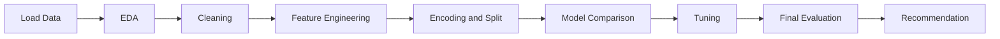
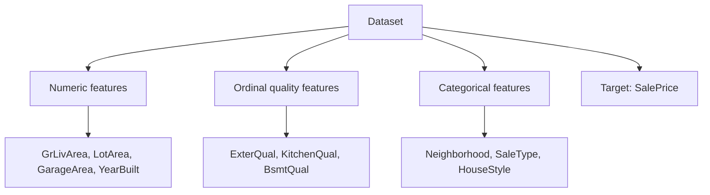
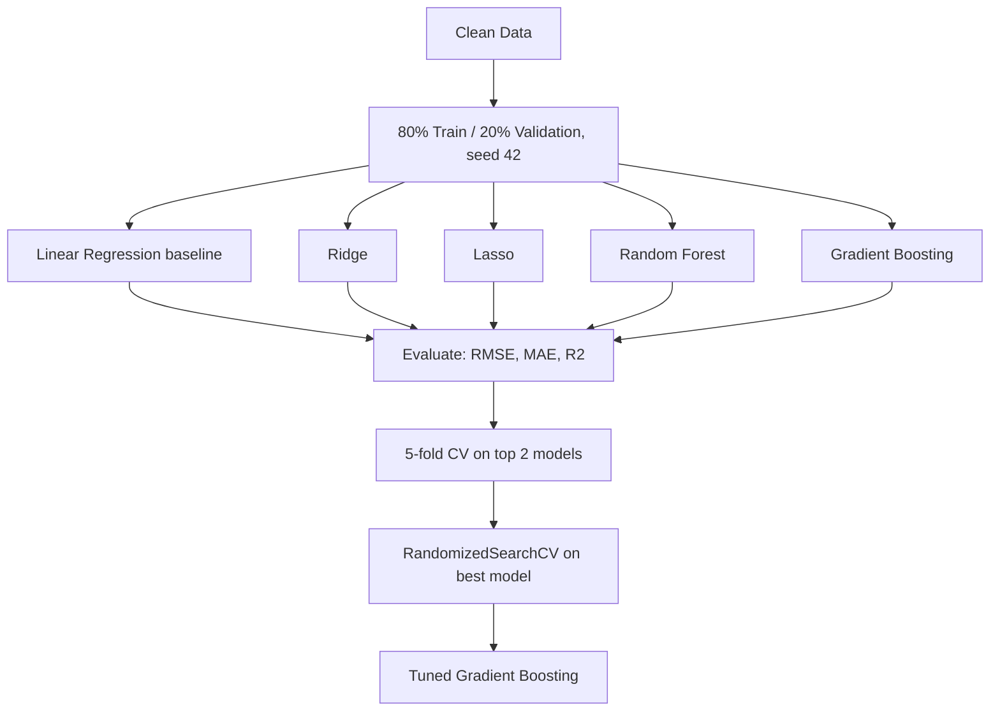

# Housing Price Prediction

**Module:** Machine Learning (Group Assignment)
**Tool:** Python / Google Colab
**Dataset:** Ames Housing (Kaggle: *House Prices - Advanced Regression Techniques*)

## 1. Project Goal

A real estate stakeholder wants a **price estimate for a house** based on its features, and to know which features drive the price.

This is a regression problem. The target is `SalePrice`, a continuous number. The model predicts `log(SalePrice)` so that very expensive houses do not dominate the error.

## 2. Files in This Repository

| File | What it is |
|---|---|
| `Housing Price Prediction.ipynb` | Full notebook (EDA, preprocessing, modelling, evaluation) |
| `train.csv` | Training data with `SalePrice` (1,460 houses) |
| `test.csv` | Houses without `SalePrice` (used only for predictions) |
| `data_description.txt` | Explains every column |
| `sample_submission.csv` | Kaggle submission format |

## 3. Workflow



## 4. Dataset Summary

- **Rows:** 1,460 houses (train)
- **Columns:** 81 (including `Id` and `SalePrice`)
- **Target:** `SalePrice` (modelled as `log(SalePrice)`)
- **Test file:** has no `SalePrice`, so it cannot be scored locally



## 5. What the Notebook Does

### Step 1 - EDA
- Check the target distribution and skewness
- Log-transform the target (skew 1.88 to 0.12)
- Look at missing values and correlations

### Step 2 - Cleaning
- Structural NaN (feature absent) filled with `'None'` or 0
- `LotFrontage` filled with the neighborhood median
- `Electrical` filled with the mode

### Step 3 - Feature Engineering
- Added `TotalSF`, `TotalBath`, `HouseAge`, `RemodAge` and flags
- Dropped `HasPool` (correlation 0.07, pools in under 1% of homes)
- Ordinal map for quality scales, one-hot for the rest

### Step 4 - Modelling



## 6. Key Decisions

| Decision | Why |
|---|---|
| Regression on `log(SalePrice)` | Target is continuous, log fixes skew |
| Scaler fit on train only | Avoids data leakage |
| Lasso `max_iter` = 10,000 | Fixes convergence warning |
| Tree ensembles over neural network | 1,460 rows is too few for deep models |
| 5-fold CV on top 2 models | Rules out a lucky split |
| RandomizedSearchCV (20 iterations) | Good coverage at lower compute cost |

## 7. Key Findings

**Model comparison (validation set, log scale)**

| Model | RMSE | MAE | R² |
|---|---|---|---|
| Linear (baseline) | 0.1548 | 0.0937 | 0.8715 |
| Ridge | 0.1546 | 0.0957 | 0.8719 |
| Lasso | 0.1563 | 0.0933 | 0.8690 |

Random Forest and Gradient Boosting were also tested. Gradient Boosting was the best (5-fold CV RMSE 0.1265 vs 0.143 for Random Forest).

**Final model: Tuned Gradient Boosting**

| Metric | Result |
|---|---|
| Best parameters | 500 trees, depth 3, learning rate 0.03, subsample 0.7 |
| R² | 0.906 |
| RMSE (log) | 0.132 |
| MAE (log) | 0.085 (about 9% typical error) |
| RMSE (dollars) | about $28,000 |
| Mean CV RMSE (5-fold) | 0.125 (+/- 0.009) |

**Other findings**
- `TotalSF` and `OverallQual` are the two most important features (about 70% of importance together)
- Residual mean is close to 0, so the model is not biased
- Results are stable across all 5 folds
- Larger errors happen on a few cheap or unusual houses

## 8. Recommendation

- Use the tuned Gradient Boosting model for price estimates
- Trust it for normal houses
- Be careful with cheap or unusual houses

## 9. Limitations

- Data comes from one city (Ames, Iowa), so it may not work elsewhere
- Big errors on a few outlier houses
- `test.csv` has no prices, so accuracy was measured on a validation split and CV only
- Only 1,460 rows

## 10. How to Run

1. Download the dataset from Kaggle
2. Open `Housing Price Prediction.ipynb` in Google Colab
3. Upload `train.csv` and `test.csv`
4. Install packages if needed:
```python
   pip install pandas numpy scikit-learn matplotlib seaborn joblib
```
5. Run all cells from top to bottom

## 11. Data Source

De Cock, D. (2011). Ames, Iowa: Alternative to the Boston Housing Data as an End of Semester Regression Project. *Journal of Statistics Education, 19*(3).

Dataset available on Kaggle: House Prices - Advanced Regression Techniques.
